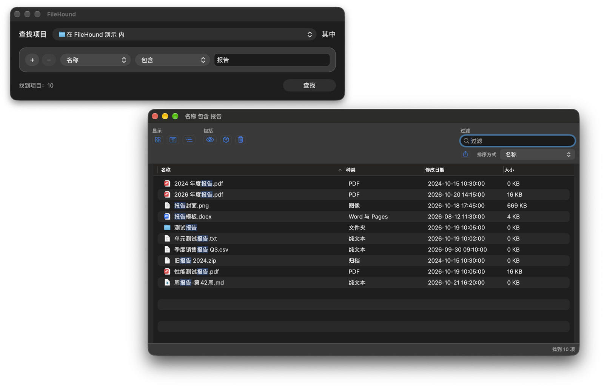

  

<h1 align="center">FileHound</h1>

  不建索引的 macOS 文件搜索工具：每次直接搜索磁盘，能找到 Spotlight 不收录的系统目录、隐藏文件和包内容。

  <a href="https://wangwanjie.github.io/FileHound/">主页</a> ·
  <a href="https://github.com/wangwanjie/FileHound/releases/latest">下载</a> ·
  <a href="https://github.com/wangwanjie/FileHound/issues">反馈</a>

FileHound 的使用体验接近 Find Any File。可以按名称、扩展名、日期、大小、种类、标签、注释、文本内容等条件组合搜索，结果在搜索过程中持续刷新。

## 下载

FileHound 为 Apple 芯片和 Intel 芯片分别提供安装包，需要 **macOS 13.0 或更高版本**：

| 芯片 | 下载最新版 |
| --- | --- |
| Apple 芯片（M1 及更新） | [FileHound-arm64.dmg](https://github.com/wangwanjie/FileHound/releases/latest/download/FileHound-arm64.dmg) |
| Intel 芯片 | [FileHound-x86_64.dmg](https://github.com/wangwanjie/FileHound/releases/latest/download/FileHound-x86_64.dmg) |

不确定是哪种芯片时，打开「苹果菜单 › 关于本机」，看「芯片」或「处理器」一栏。历史版本见 [Releases](https://github.com/wangwanjie/FileHound/releases)。macOS 12 用户可以继续使用 [1.3.0](https://github.com/wangwanjie/FileHound/releases/tag/v1.3.0)。

安装包已经过 Apple 公证，打开 DMG 后把 FileHound 拖进「应用程序」文件夹即可。应用内会自动检查更新，并且只会下载与本机芯片匹配的版本。

## 权限

搜索系统目录或其他 App 的数据时，建议在「系统设置 › 隐私与安全性 › 完全磁盘访问权限」中允许 FileHound。偏好设置的「权限」页可以检查当前的授权状态。

完全磁盘访问只解除隐私保护，FileHound 仍以当前账户身份读取文件。要搜索其他用户的主目录、`/private/var/root` 等只有 root 能读取的位置，在「权限」页安装特权辅助程序，并在「系统设置 › 通用 › 登录项」中允许。辅助程序以 root 身份在后台按需运行，只读取文件；只有当前账户无权读取时才会经由它访问，不影响普通搜索的速度。

## 功能

- **组合条件搜索**：名称、扩展名、路径、文件夹名、修改 / 创建 / 上次打开日期、大小、种类、标签、注释、文本内容、脚本等条件，条件之间是“且”的关系。支持通配符、正则表达式、“包含任一”等运算符，也可以区分大小写和变音符号。
- **搜索范围**：启动卷、所有磁盘、主目录、访达当前选中的文件夹、最近使用的位置，或任意文件夹（可以直接从访达拖到查找窗口）。可以设置包含或排除不可见项目、包内容和废纸篓，限制文件夹深度和结果数量。
- **快**：多线程批量遍历目录，搜索整个卷时直接扫描卷目录，同时用 Spotlight 预取第一屏结果。详见下文[为什么查找这么快](#为什么查找这么快)。
- **结果浏览**：提供列表、树形、网格三种视图，可以过滤、排序和 Quick Look 预览。支持打开、在访达中显示、重命名、移到废纸篓（可放回原处）、设置标签、拷贝路径，也可以把结果直接拖到访达或其他 App。
- **导出结果**：可以把当前结果导出为 CSV（可用 Excel / Numbers 打开）或纯文本路径列表，快捷键 ⇧⌘E。
- **多窗口**：⌘N 另开一个查找窗口，各窗口的条件和结果互不影响。搜索进行中可以提前查看已找到的结果；⌘R 会按结果窗口自己的条件重新搜索。
- **常用操作**：存储常用搜索，查看最近的搜索记录，用全局快捷键随时唤起查找窗口。
- **界面**：支持简体中文、繁体中文、英文，可以在应用内切换语言，无需重启；外观可选浅色、深色或跟随系统。

## 为什么查找这么快

FileHound 不维护自己的索引：没有常驻后台进程，不占额外磁盘，每次搜索看到的都是磁盘此刻的真实状态。不建索引还能快，靠的是尽量少做系统调用、把 I/O 并行起来，以及能不读的就不读：

- **批量列目录**：用 `getattrlistbulk` 一次系统调用取回一批子项的名称和类型，省掉逐个文件的 `stat`。单线程遍历 `/System/Library` 从 46.8s 降到 5.7s。
- **多线程遍历**：最多 8 个线程共享一个待遍历目录栈，内存占用平稳。整体比 BSD `find` 快约 7.7 倍。
- **直接扫描卷目录**：搜索整个磁盘时用 `searchfs` 让内核扫描卷的目录结构，多个卷并发搜索，分批交回结果。搜索整个启动卷比多线程遍历快约 1.5 倍，也能找到遍历进不去的目录中的条目。
- **廉价规则先判**：只看名称、路径的规则先判，需要读属性、读内容的规则靠后，属性按需读取并缓存。
- **内容搜索按字节预筛**：小文件一次读入、大文件内存映射，先按字节查找关键词的常见编码，必要时才解码比较。在 macOS SDK 中搜索一个标识符比 BSD `grep -r` 快约 9.7 倍，与 ripgrep 处在同一量级。
- **先出结果**：Spotlight 预取与磁盘搜索并行，通常不到一秒就给出第一批结果，随后持续补全。

Spotlight 不区分大小写，也不收录系统目录、隐藏文件和包内容，所以 FileHound 只拿它预取第一批结果，每一条仍按完整条件复核，最终结果以卷目录搜索或遍历为准。

## 性能测试

以下结果测于 2026-10-02，Apple M2 Max（12 核）、32 GB 内存、macOS 27.2，目录与文件缓存都已热，取 3 次的中位数。测的是搜索引擎核心，不含 App 生成结果行和渲染界面的开销。

| 场景 | 对比对象 | FileHound |
| --- | --- | --- |
| `/System/Library`（约 46 万个条目）按名称搜索 `plist` | `find -iname` 11.81 s | **1.52 s** |
| 整个启动卷（约 707 万个对象）按名称搜索 `plist` | 多线程遍历 48.49 s | **31.89 s**（卷目录搜索） |
| macOS SDK Frameworks（约 1.3 万个条目）按内容搜索 `kCFAllocatorDefault` | `grep -rlF` 3.51 s，`rg` 0.31 s | **0.36 s** |

名称条件只含字母时，忽略变音符号（默认）的搜索会改用多线程遍历；名称中含数字、汉字等字符，或勾选“区分变音符号”时，会走卷目录搜索。冷缓存下各实现都会明显变慢，请以数量级和相对关系为准。

## 反馈

遇到问题或有功能建议，欢迎在 [Issues](https://github.com/wangwanjie/FileHound/issues) 中反馈。本仓库只用于发布安装包与更新信息，不包含源代码。

## 致谢

FileHound 使用了以下开源库：[Sparkle](https://github.com/sparkle-project/Sparkle)、[SnapKit](https://github.com/SnapKit/SnapKit)、[MMKV](https://github.com/Tencent/MMKV)。

Copyright © 2026 VanJay. All rights reserved.
